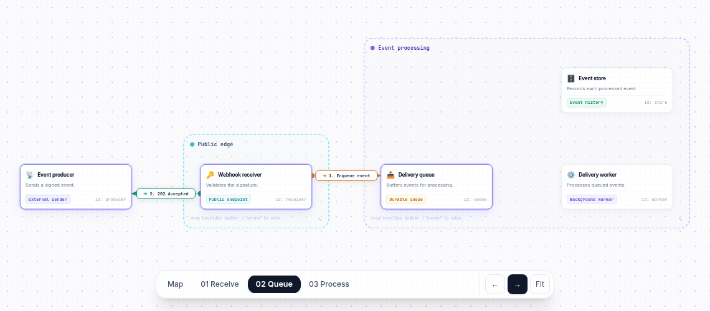

<h1 align="center">System Flow Diagrams</h1>

<p align="center"><strong>Walk through a system, one phase at a time.</strong><br>
An open-source Agent Skill for turning architecture and API flows into interactive HTML.</p>

<p align="center">
  <a href="https://clarkohlenbusch.github.io/system-flow-diagrams/examples/webhook-delivery.html"><strong>Try the live demo</strong></a>
  &nbsp;·&nbsp;
  <a href="#quick-start">Install</a>
  &nbsp;·&nbsp;
  <a href="#contributing">Contribute</a>
</p>

[](https://clarkohlenbusch.github.io/system-flow-diagrams/examples/webhook-delivery.html)

The demo follows a signed webhook through a receiver, queue, worker, and event store. Click a phase to see its messages, or drag a service and watch its arrows follow. [HTML source](examples/webhook-delivery.html) · [Still image](examples/screenshots/webhook-processing.png)

## Quick start

Run this from your project directory and select your agent if prompted.

```sh
npx skills add ClarkOhlenbusch/system-flow-diagrams --skill system-flow-diagrams
```

Ask your agent to use `system-flow-diagrams`. In Codex, type `$system-flow-diagrams` to select it. [View on skills.sh](https://skills.sh/clarkohlenbusch/system-flow-diagrams/system-flow-diagrams)

> Create an interactive HTML diagram of our webhook flow. Show signature validation, queuing before HTTP 202, and processing by the background worker.

Open the generated HTML in your browser. Use the phase buttons or arrow keys to advance, **F** to fit, and **R** to reset. On a phone, **pinch with two fingers to zoom**, move both fingers to pan, and swipe the phase bar to reach more steps. One finger can drag a card or pan empty canvas. Tap **Fit** to see the whole diagram again.

For manual setup, keep the skill folder together and point your agent at its instructions. [Download the repository](https://github.com/ClarkOhlenbusch/system-flow-diagrams/archive/refs/heads/main.zip) · [Read the skill](system-flow-diagrams/SKILL.md)

## Order checkout

Follow a checkout from identity verification to payment authorization and receipt delivery. [Live demo](https://clarkohlenbusch.github.io/system-flow-diagrams/system-flow-diagrams/assets/starter.html) · [HTML source](system-flow-diagrams/assets/starter.html)

[](https://clarkohlenbusch.github.io/system-flow-diagrams/system-flow-diagrams/assets/starter.html)

## What the plugin uses

The skill copies a bundled starter and writes diagram data into the HTML file in your project. When you open a diagram, your browser loads libraries from `cdn.tailwindcss.com` and `unpkg.com` and fonts from `fonts.googleapis.com` and `fonts.gstatic.com`.

## Contributing

Tried it on a real workflow? Share an example, suggest an improvement, or tell us what you had to fix by hand. [Open an issue](https://github.com/ClarkOhlenbusch/system-flow-diagrams/issues/new)

Changes to the skill, starter, examples, and docs are welcome. [Contributing guide](CONTRIBUTING.md)

## License

[MIT](LICENSE). Libraries and fonts loaded from CDNs retain their own licenses.
