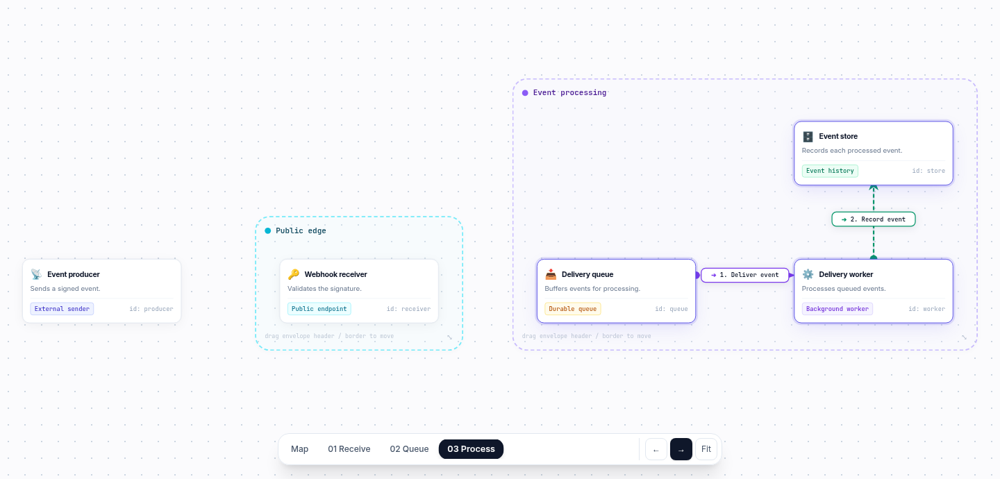
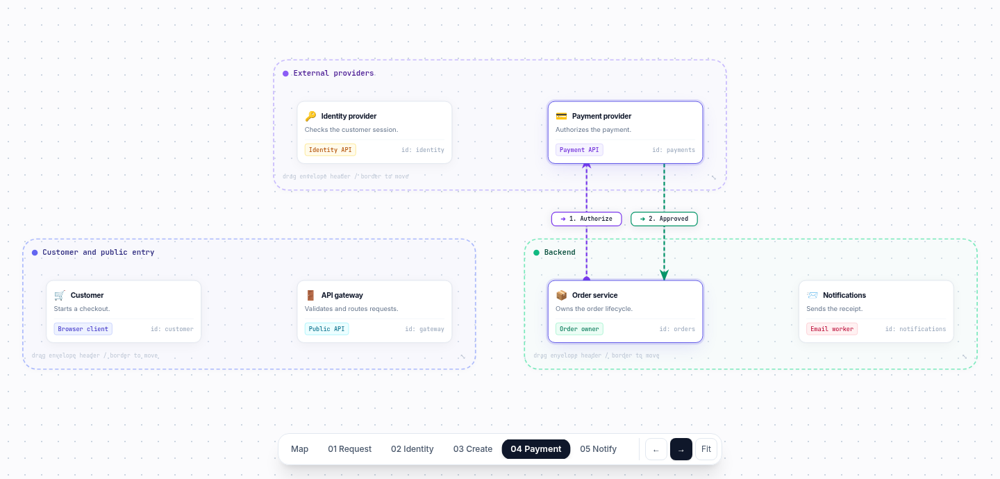

# System Flow Diagrams

An open-source Agent Skill for turning software architecture, API requests, and event-driven workflows into interactive HTML diagrams. Drag components and boundaries, follow labeled arrows, and step through each phase from the bottom dock.

[Try the live demo](https://clarkohlenbusch.github.io/system-flow-diagrams/) · [Read the skill](system-flow-diagrams/SKILL.md) · [Install](#install)

## Examples

### Webhook delivery

A signed event reaches a public receiver, enters a durable queue, and gets recorded by a background worker. The screenshot shows the **Process** phase.



[Open the interactive webhook example](https://clarkohlenbusch.github.io/system-flow-diagrams/examples/webhook-delivery.html) · [View the HTML source](examples/webhook-delivery.html)

> Create an interactive HTML architecture diagram for webhook delivery. Show a producer sending a signed event, a receiver validating it and durably queuing it before returning HTTP 202, and a worker recording it in the event store. Keep the public edge and event-processing boundaries visible.

### Order checkout

Follow a checkout through identity verification, order creation, payment authorization, and receipt delivery. The screenshot shows the **Payment** phase with separate request and response arrows.



[Open the interactive checkout starter](https://clarkohlenbusch.github.io/system-flow-diagrams/system-flow-diagrams/assets/starter.html) · [View the HTML source](system-flow-diagrams/assets/starter.html)

> Create `checkout.html` from our checkout architecture. Show the customer, API gateway, identity provider, order service, payment provider, and receipt worker. Split the flow into request, identity, order creation, payment, and notification phases.

[See how the skill works](https://clarkohlenbusch.github.io/system-flow-diagrams/) · [View the walkthrough source](how-it-works.html)

## Install

From the project where you want to use the skill, run the [skills CLI](https://skills.sh/docs/cli):

```sh
npx skills add ClarkOhlenbusch/system-flow-diagrams --skill system-flow-diagrams
```

Select your agent if prompted. To target Codex in a script, append `--agent codex --yes`. In Codex, type `$system-flow-diagrams` or select it from `/skills`, then describe the diagram you want.

You can also [download the repository](https://github.com/ClarkOhlenbusch/system-flow-diagrams/archive/refs/heads/main.zip) or clone it and ask your coding agent to read `system-flow-diagrams/SKILL.md`. Keep the complete skill folder together so it can find the starter and layout guide.

## Use the diagram

Open the generated HTML file in a browser. It needs an internet connection to load its libraries and fonts from CDNs. You can open the file directly without installing dependencies or running a server.

- Click the phase buttons or press Space or Left/Right. Number keys jump to a phase, with **0** for Map.
- Drag cards to move them. Their connections follow. Drag a boundary header or border to move the boundary independently, or drag its lower-right corner to resize it.
- Drag empty canvas to pan. Use Ctrl, Cmd, or Alt with scroll, or use +/− to zoom. Press **F** to fit and **R** to restore the saved layout.

Edits on the canvas last for the current page session. Update the diagram data in the HTML file to save a layout.

## Customize the starter

Copy the starter and edit the section between `BEGIN DIAGRAM DATA` and `END DIAGRAM DATA`. It contains three definitions:

- `INITIAL_NODES` defines components and placement.
- `INITIAL_ENVELOPES` defines labeled boundaries.
- `STORYBOARD_STEPS` defines messages and highlights for each phase.

The [skill instructions](system-flow-diagrams/SKILL.md) describe the authoring workflow. The [layout guide](system-flow-diagrams/references/layout.md) covers spacing, label and port choices, boundary fitting, and verification.

## Share a live demo with GitHub Pages

For a fork, open **Settings → Pages**, choose **Deploy from a branch**, select **main** and **/(root)**, then save. The included `index.html` opens the walkthrough, and `.nojekyll` keeps the files static.

## Contribute

Preserve the working canvas and minimal controls. For changes to the starter, inspect every phase and test dragging after pan and zoom, independent boundary movement and resizing, navigation, and reset. Check labels and paths at both presentation and laptop sizes. Use generic examples without private architecture details.

Licensed under [MIT](LICENSE). CDN-provided dependencies retain their own licenses.
